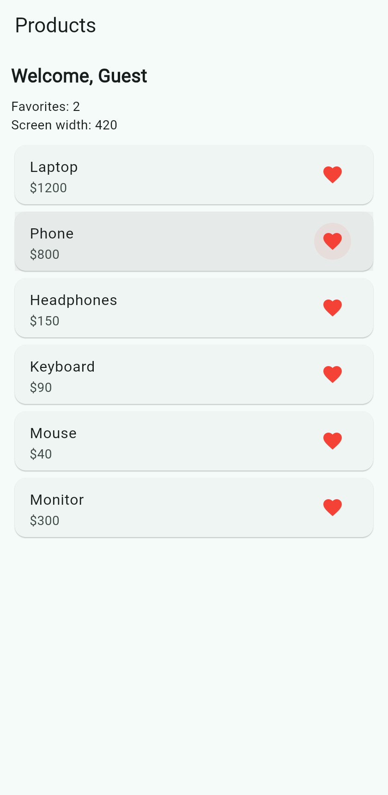
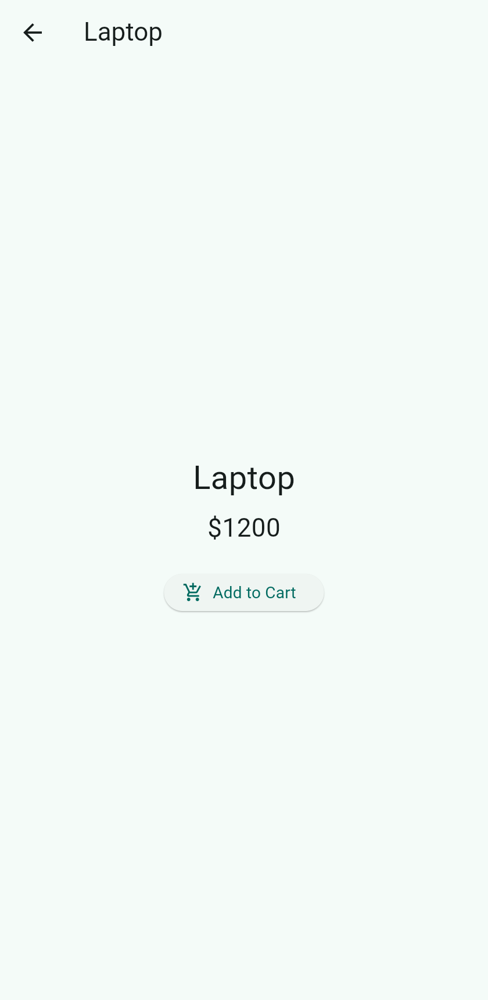
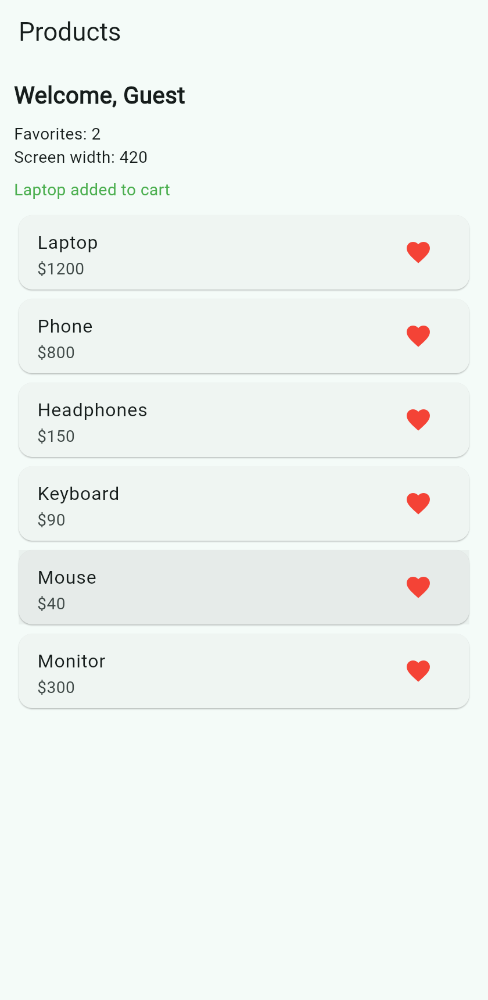
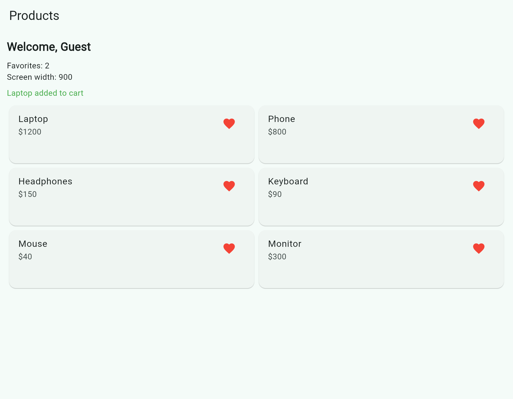
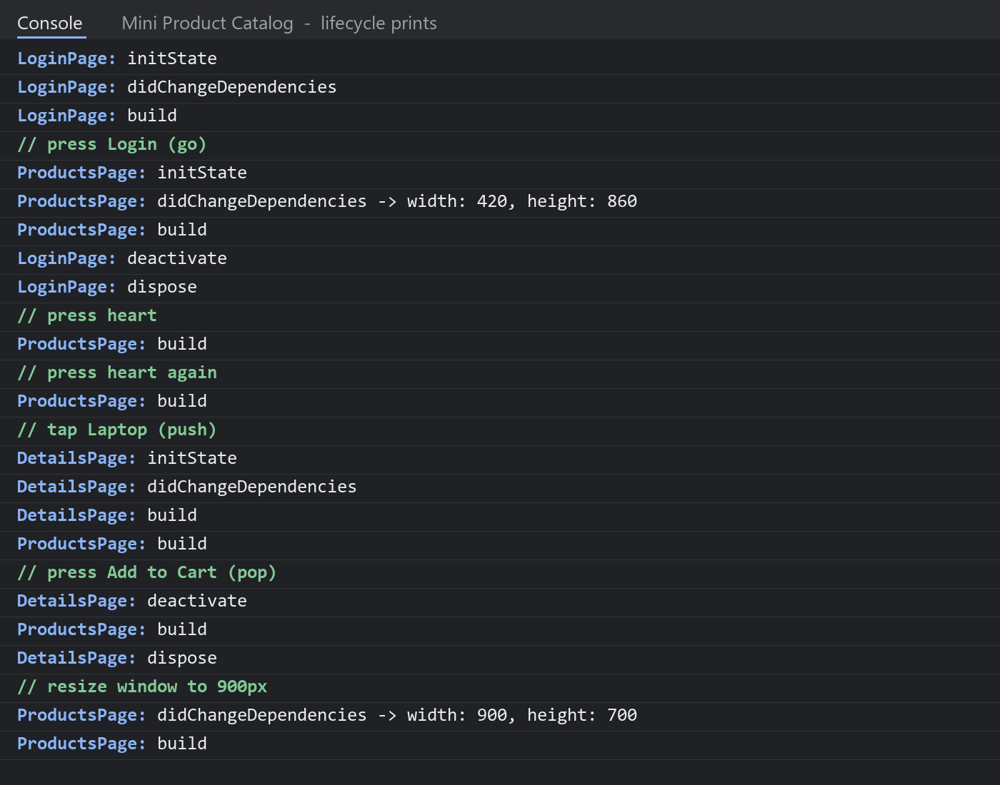

# Mini Product Catalog – Flutter (Section 4 homework)

**Live demo:** https://mohamedahmed2059.github.io/flutter-mini-product-catalog/

A small app with 3 screens (**Login → Products → Product Details**) to practice the StatefulWidget lifecycle, `Navigator` and `go_router`.

| Products (width < 600, list) | Details | Back with the result | Wide window (≥ 600, grid) |
|---|---|---|---|
|  |  |  |  |

## Debug console (lifecycle prints)


These are the real prints from the running app: Login → heart twice → open Laptop → Add to Cart → resize the window to 900px. The raw text is in [`screenshots/console_log.txt`](screenshots/console_log.txt).

## Part 1 – Lifecycle
- All 3 pages are StatefulWidgets.
- Each page overrides `initState`, `didChangeDependencies`, `build`, `deactivate` and `dispose`, with a print in each one.
- Products page:
  - A "Favorites: X" counter, increased with `setState` from the heart button.
  - `didChangeDependencies` reads `MediaQuery.sizeOf(context)`, prints the width and height, and shows "Screen width: …" on the screen.
  - Under 600px the products show as a `ProductsListView`, from 600px as a `ProductsGridView` (from `product_widgets.dart`).
- The answers to questions a–d are in the comment at the top of [`lib/main.dart`](lib/main.dart).

## Part 2 – Navigator (kept, commented out)
- **Login → Products:**
  - `Navigator.pushNamed(context, '/products', arguments: 'Guest')`.
  - The `/products` route reads it with `ModalRoute.of(context)!.settings.arguments` and passes it to `ProductsPage(username: ...)`.
- **Products → Details:** `Navigator.push` with `DetailsPage(name: ..., price: ...)`.
- **Details → back:** `Navigator.pop(context, 'Laptop added to cart')`. Products receives it with `await` and shows it with `setState`.

## Part 3 – go_router (active)
| Route | Name | Reads |
|---|---|---|
| `/` | – | LoginPage |
| `/products?user=Guest` | `products` | query parameter `user` |
| `/details/:name/:price` | `details` | path parameters `name` and `price` |

- **Login → Products:** `context.goNamed('products', queryParameters: {'user': 'Guest'})`. The user can't go back to Login.
- **Products → Details:** `await context.push('/details/Laptop/1200')`.
- **Details → back:** `context.pop('Laptop added to cart')`, and the text shows on the Products page.

## Part 4 – Short answers
In the comment at the top of [`lib/main.dart`](lib/main.dart).

## Run it
```bash
flutter pub get
flutter run -d chrome
```
